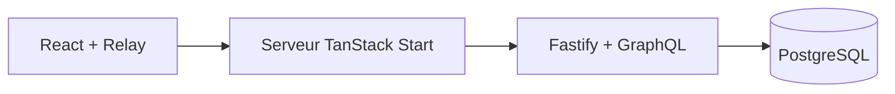

# Tickets Kanban

Application de gestion de tickets construite pour explorer une architecture
full stack TypeScript : rendu serveur, API GraphQL, cache client normalisé
et persistance PostgreSQL.

## Fonctionnalités

- Création, consultation, modification et suppression des tickets.
- Kanban avec les statuts À faire, En cours, Terminé et Annulé.
- Déplacement entre colonnes par glisser-déposer ou menu de statut.
- Recherche dans les titres et descriptions.
- Fiche détaillée avec formulaire d’édition.
- Validation côté client et côté API.
- Notifications de confirmation et conservation de la saisie après une erreur.

Le déplacement change le statut du ticket. L’ordre manuel des cartes
à l’intérieur d’une colonne n’est pas persisté.

## Stack

| Partie              | Technologies                                   |
| ------------------- | ---------------------------------------------- |
| Interface           | React, TanStack Start, TanStack Router         |
| Formulaires         | TanStack Form                                  |
| Données côté client | Relay et types générés depuis GraphQL          |
| Composants          | shadcn/ui avec Base UI, Tailwind CSS, Lucide   |
| Kanban              | dnd-kit                                        |
| API                 | Node.js, Fastify, Mercurius, GraphQL           |
| Base de données     | PostgreSQL, Drizzle ORM                        |
| Monorepo            | Bun workspaces, Turborepo                      |
| Vérifications       | TypeScript, Oxlint, Prettier, Node Test Runner |

## Architecture

```text
apps/
  web/       Application React et serveur TanStack Start
  api/       API GraphQL et accès à PostgreSQL
packages/
  ui/        Composants et styles partagés
```



Les types Relay sont générés depuis le schéma de l’API.

Les changements de statut utilisent une mise à jour optimiste :
l’interface réagit immédiatement et revient à l’état précédent
si la requête échoue.

L’édition et la suppression sont confirmées après la réponse du serveur.

## Lancement local

Prérequis : Node.js 26, Bun 1.4.4 et Docker avec Docker Compose.

Après avoir cloné le dépôt, depuis sa racine :

```bash
bun install --frozen-lockfile

cp .env.example .env
cp apps/api/.env.example apps/api/.env
cp apps/web/.env.example apps/web/.env

docker compose up --wait db

cd apps/api
bun run db:migrate
cd ../..

bun run dev
```

Les exemples contiennent une configuration de développement local.
Si le mot de passe PostgreSQL change, adapter aussi `DATABASE_URL`.

| Service                            | Adresse                        |
| ---------------------------------- | ------------------------------ |
| Application                        | http://localhost:5173          |
| GraphQL                            | http://127.0.0.1:4001/graphql  |
| GraphiQL, en développement         | http://127.0.0.1:4001/graphiql |
| PostgreSQL, depuis la machine hôte | 127.0.0.1:5434                 |

Pour arrêter PostgreSQL en conservant les données :

```bash
docker compose stop db
```

## Vérifications

Depuis la racine :

```bash
bun run format:check
bun run lint
bun run test
bun run build
```

Les tests utilisent le runner de Node.js et l’injection HTTP de Fastify.
Ils vérifient le schéma GraphQL, les validations, les resolvers et
la gestion des erreurs avec un repository simulé.

Ils peuvent être exécutés sans PostgreSQL. Cette suite ne vérifie pas
les requêtes SQL sur une base réelle ni les interactions du navigateur.

## Périmètre actuel

Le projet fonctionne en local avec un espace de tickets partagé.
L’authentification, les espaces par utilisateur et la synchronisation
en temps réel entre navigateurs ne sont pas implémentés.
